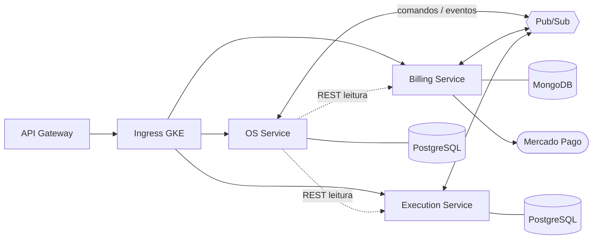

# Oficina Mecânica — OS Service

Back-end da oficina mecânica do Tech Challenge da Pós-Tech SOAT (FIAP).

Na **Fase 4** a aplicação foi dividida em **três microsserviços independentes**, cada um com
repositório, banco, pipeline de CI/CD e manifestos Kubernetes próprios. Este repositório é o
**OS Service**: ordens de serviço, cadastros, autenticação de funcionários e o **orquestrador da saga**
que coordena orçamento, pagamento e execução entre os serviços.

| Serviço | Repositório | Banco |
|---|---|---|
| **OS Service** (este) | [`oficina`](https://github.com/robsonago/oficina) | PostgreSQL |
| **Billing Service** — orçamento e pagamento (Mercado Pago) | [`oficina-billing-service`](https://github.com/robsonago/oficina-billing-service) | MongoDB |
| **Execution Service** — fila de execução | [`oficina-execution-service`](https://github.com/robsonago/oficina-execution-service) | PostgreSQL |

> Histórico: o README das fases 1 a 3 (monólito hexagonal, GKE, API Gateway, function de CPF,
> New Relic) está preservado em [`docs/fases/README-fase3.md`](docs/fases/README-fase3.md).

---

## Índice

1. [O que mudou na Fase 4](#1-o-que-mudou-na-fase-4)
2. [Arquitetura](#2-arquitetura)
3. [Saga Pattern](#3-saga-pattern)
4. [Comunicação entre os serviços](#4-comunicação-entre-os-serviços)
5. [Como executar](#5-como-executar)
6. [API](#6-api)
7. [Testes e qualidade](#7-testes-e-qualidade)
8. [CI/CD](#8-cicd)
9. [Kubernetes e infraestrutura](#9-kubernetes-e-infraestrutura)
10. [Observabilidade](#10-observabilidade)
11. [Documentação](#11-documentação)
12. [Segurança](#12-segurança)

---

## 1. O que mudou na Fase 4

- **Microsserviços**: orçamento/pagamento e execução saíram deste serviço para o Billing e o
  Execution Service. Nenhum serviço acessa o banco de outro.
- **SQL + NoSQL**: PostgreSQL aqui e no Execution; MongoDB no Billing.
- **Saga orquestrada** com compensação em todas as etapas (seção 3).
- **Mensageria**: Pub/Sub com transactional outbox, idempotência e dead letter; REST síncrono só para
  consultas, com circuit breaker.
- **Mercado Pago** no Billing (Checkout Pro, webhook com validação de assinatura, estorno).
- **Qualidade**: testes unitários nos três serviços, **BDD com Cucumber** do fluxo completo,
  cobertura mínima de **80% que quebra o build** e SonarCloud no CI.
- **CI/CD independente** por serviço, com deploy automatizado no GKE usando os manifestos de cada
  repositório (`k8s/`), e `main` protegida por PR + checks.

## 2. Arquitetura

Diagrama completo, diagramas de sequência e máquina de estados em
[`docs/arquitetura/arquitetura-fase4.md`](docs/arquitetura/arquitetura-fase4.md).



### Divisão dos microsserviços

| Serviço | Responsabilidades | Por que separado |
|---|---|---|
| OS Service | abertura da OS, status e histórico, cadastros (cliente, veículo, serviços, peças/estoque), login de funcionário, orquestração da saga | dono do agregado Ordem de Serviço e do status que o cliente acompanha |
| Billing Service | gerar/enviar orçamento, aprovação, cobrança e estorno no Mercado Pago | regras de cobrança e o gateway de pagamento mudam e falham independente do resto |
| Execution Service | fila de execução, diagnóstico e reparo, finalização | é a operação da oficina; escala com o número de mecânicos/filiais |

Justificativa completa (contextos do DDD, escolha dos bancos e tecnologias) em
[RFC-004](docs/rfcs/004-divisao-microsservicos-e-bancos.md).

### Estrutura deste serviço (hexagonal)

```
src/main/java/br/com/fiap/challange/oficina/
├── domain/
│   ├── model/        OrdemServico, StatusOS, SagaOrdemServico, EtapaSaga, HistoricoStatusOS, TiposMensagem...
│   └── port/         in: OrdemServicoInputPort, OrquestradorSagaInputPort · out: repositórios, ComandosSagaPort...
├── application/usecase/
│   ├── OrquestradorSagaOS   ← a saga inteira e as compensações
│   ├── GestorStatusOS       ← toda mudança de status passa aqui (valida + grava histórico)
│   ├── EstoqueService       ← reserva/devolução de peças (passo e compensação da saga)
│   └── OrdemServicoUseCase, ClienteUseCase, ...
└── infrastructure/
    ├── adapter/in/rest            controllers
    ├── adapter/in/messaging       EventosSagaListener (idempotente)
    ├── adapter/in/scheduler       VerificadorPrazosSaga
    ├── adapter/out/persistence    JPA (OS, saga, histórico, outbox)
    ├── adapter/out/mensageria     OutboxComandosAdapter + RelayOutbox
    ├── adapter/out/rest           AcompanhamentoRestAdapter (Resilience4j)
    └── messaging/                 Pub/Sub + propagação de trace
```

## 3. Saga Pattern

**Estratégia escolhida: saga orquestrada**, com o OS Service como orquestrador.
Decisão e alternativas no [ADR-003](docs/adrs/003-saga-orquestrada.md).

**Por que orquestração e não coreografia:** o fluxo tem seis etapas e cinco caminhos de compensação.
Com coreografia, a regra "o que vem depois" e "o que desfazer quando falhar" ficaria espalhada pelos
três serviços, e entender uma falha exigiria juntar logs de todos eles. Com um orquestrador, o fluxo
inteiro está em uma classe (`OrquestradorSagaOS`), o estado de cada saga fica gravado com todos os
passos e pode ser consultado pela API (`GET /api/ordens-servico/{id}/saga`). O OS Service já é o dono
da OS e do status que o cliente vê, então é o lugar natural para coordenar.

```
gerar-orcamento ─► GERAR_ORCAMENTO ─► Billing ─► ORCAMENTO_GERADO ─► cliente aprova ─► ORCAMENTO_APROVADO
   ─► reserva de peças ─► Mercado Pago ─► PAGAMENTO_APROVADO ─► EXECUTAR_OS ─► Execution
   ─► EXECUCAO_ATUALIZADA ─► EXECUCAO_FINALIZADA ─► OS FINALIZADA (saga CONCLUIDA)
```

| Se falhar... | Compensação |
|---|---|
| geração do orçamento | OS volta para diagnóstico |
| cliente rejeita | OS volta para diagnóstico |
| falta peça na hora da aprovação | cancela o orçamento no Billing, OS cancelada |
| pagamento recusado / prazo de pagamento vencido | devolve as peças, cancela o orçamento, OS cancelada |
| execução impossível | devolve as peças, **estorna o pagamento no Mercado Pago**, OS cancelada |

Garantias: outbox transacional (o comando só sai se a mudança de estado foi gravada), consumidores
idempotentes, guarda por etapa contra mensagens repetidas ou fora de ordem, lock otimista na saga,
prazos por etapa e dead letter após 5 tentativas.

## 4. Comunicação entre os serviços

| Tipo | Onde | Para quê |
|---|---|---|
| **Assíncrona (Pub/Sub)** | `oficina-billing-comandos`, `oficina-execucao-comandos`, `oficina-os-eventos` | todos os passos da saga ([ADR-004](docs/adrs/004-mensageria-pubsub-outbox.md)) |
| **Síncrona (REST)** | `GET /api/ordens-servico/{id}/acompanhamento` | visão consolidada da OS, consultando Billing e Execution com timeout de 2s e circuit breaker; se um serviço cair, a resposta vem parcial com `indisponiveis` |
| **Webhook** | Mercado Pago → Billing | confirmação de pagamento |

## 5. Como executar

### 5.1 Ambiente completo local (docker compose)

Clone os três repositórios lado a lado:

```bash
git clone https://github.com/robsonago/oficina.git
git clone https://github.com/robsonago/oficina-billing-service.git
git clone https://github.com/robsonago/oficina-execution-service.git

cd oficina
docker compose up -d --build
```

Sobe os três serviços, um PostgreSQL para o OS Service, outro para o Execution, MongoDB para o
Billing e o **emulador oficial do Pub/Sub** com os mesmos tópicos/assinaturas do GCP.

| Serviço | URL |
|---|---|
| OS Service | http://localhost:8080/swagger-ui.html |
| Billing Service | http://localhost:8081/billing/swagger-ui.html |
| Execution Service | http://localhost:8082/execucao/swagger-ui.html |

Usuário padrão: `admin` / `admin123` (o mesmo token vale nos três serviços).

### 5.2 Demonstração da saga em um comando

```bash
python3 scripts/demo_saga.py                                # caminho feliz até a entrega
python3 scripts/demo_saga.py --cenario pagamento-recusado   # compensação: devolve peças, cancela orçamento
python3 scripts/demo_saga.py --cenario falha-execucao       # compensação: devolve peças, estorna pagamento
python3 scripts/demo_saga.py --base https://<api-gateway>   # mesmo roteiro contra o GCP
```

O script usa só as APIs REST públicas dos três serviços e imprime, no fim, o histórico da OS e os
passos da saga. Saída real do caminho feliz:

```
 4. Mecânico pede o orçamento → início da saga
   ✓ HTTP 202, OS AGUARDANDO_ORCAMENTO — comando GERAR_ORCAMENTO saiu pela outbox
   ✓ OS 1 agora está AGUARDANDO_APROVACAO (1.0s)
 ...
   saga 5c8ac2a7-... — etapa final CONCLUIDA
   00:07:18  SAGA_INICIADA          Pedido de orçamento enviado ao Billing
   00:07:19  ORCAMENTO_GERADO       Orçamento 6af7a637... enviado ao cliente (R$ 371)
   00:07:20  ORCAMENTO_APROVADO     Orçamento aprovado, peças reservadas, aguardando pagamento
   00:07:21  PAGAMENTO_APROVADO     Pagamento 1653097711221 confirmado, OS enviada para a fila de execução
   00:07:23  EXECUCAO_ATUALIZADA    Execução: EM_DIAGNOSTICO (admin)
   00:07:25  EXECUCAO_ATUALIZADA    Execução: EM_REPARO (admin)
   00:07:25  EXECUCAO_FINALIZADA    Serviço concluído, saga finalizada
```

### 5.3 Só este serviço

```bash
docker run -d -p 5432:5432 -e POSTGRES_DB=oficina -e POSTGRES_USER=oficina -e POSTGRES_PASSWORD=oficina123 postgres:16-alpine
./mvnw spring-boot:run        # mensageria em memória (MENSAGERIA_PROVIDER=memoria)
```

## 6. API

- Swagger: `/swagger-ui.html`
- Collection Postman (os três serviços, com o fluxo completo da saga e os cenários de compensação):
  [`collection/oficina-api.postman_collection.json`](collection/oficina-api.postman_collection.json)

### Ordens de serviço

| Método | Endpoint | Descrição |
|---|---|---|
| POST | `/api/ordens-servico` | abrir OS (com serviços e peças opcionais) |
| GET | `/api/ordens-servico` · `/ativas` | OS em andamento, da mais adiantada para a mais nova |
| GET | `/api/ordens-servico/{id}` | detalhes |
| GET | `/api/ordens-servico/{id}/status` | status (**público**, para o cliente acompanhar) |
| GET | `/api/ordens-servico/status/{status}` | filtrar por status |
| POST | `/api/ordens-servico/{id}/iniciar-diagnostico` | RECEBIDA → EM_DIAGNOSTICO |
| POST | `/api/ordens-servico/{id}/servicos` · `/pecas` | adicionar itens (em diagnóstico) |
| POST | `/api/ordens-servico/{id}/gerar-orcamento` | **inicia a saga** (HTTP 202) |
| POST | `/api/ordens-servico/{id}/entregar` | FINALIZADA → ENTREGUE |
| GET | `/api/ordens-servico/{id}/historico` | histórico de status com a origem de cada mudança |
| GET | `/api/ordens-servico/{id}/saga` | sagas da OS com etapa atual e todos os passos |
| GET | `/api/ordens-servico/{id}/acompanhamento` | OS + histórico + saga + orçamento + execução |
| GET | `/api/ordens-servico/estatisticas` | tempo médio e contagens |

Aprovação de orçamento e pagamento estão no **Billing** (`/api/orcamentos`, `/api/pagamentos`);
diagnóstico, reparo e finalização da execução estão no **Execution** (`/api/execucoes`). Pelo API
Gateway tudo fica na mesma URL — o Ingress separa por prefixo.

### Cadastros e autenticação

Sem mudança desde a Fase 3: `/api/auth`, `/api/clientes`, `/api/veiculos`, `/api/servicos`,
`/api/pecas` (tabelas completas em [`docs/fases/README-fase3.md`](docs/fases/README-fase3.md#11-endpoints-principais)).
Clientes continuam se autenticando por CPF pela function `oficina-auth-function`; o token emitido
por ela também é aceito pelo Billing (o cliente só vê e aprova os próprios orçamentos).

## 7. Testes e qualidade

```bash
./mvnw verify
```

| Tipo | Onde | O que cobre |
|---|---|---|
| Unitários | `domain/`, `service/`, `saga/`, `security/`, `filter/`, `controller/` | regras de domínio, casos de uso, orquestrador (eventos fora de ordem, prazos, falhas) |
| Integração | `integration/*IT.java` | API completa com Spring Boot + H2, incluindo a saga recebendo eventos |
| **BDD** | [`features/saga_ordem_servico.feature`](src/test/resources/features/saga_ordem_servico.feature) | **7 cenários** em português: caminho feliz até a entrega, pagamento recusado, falha na execução com estorno, falta de estoque, rejeição, prazo vencido e mensagem duplicada |
| Mensageria real | `infrastructure/messaging/PubSubEmuladorIT` | publicação/consumo no emulador oficial do Pub/Sub (Testcontainers) |
| REST resiliente | `infrastructure/rest/AcompanhamentoRestAdapterTest` | repasse de token/correlation id e circuit breaker abrindo |

### Cobertura

O `jacoco-maven-plugin` tem a regra `LINE COVEREDRATIO >= 0.80`: **o build falha** abaixo disso, e o
pipeline publica o percentual no resumo de cada execução. Resultado da última execução local:

| Serviço | Testes | Cobertura de linhas |
|---|---|---|
| OS Service | 252 (inclui 7 cenários BDD) | **94,7%** |
| Billing Service | 63 | **96,2%** |
| Execution Service | 23 | **96,2%** |

Relatórios: `target/site/jacoco/index.html` (cobertura) e `target/cucumber-report.html` (BDD). No
GitHub Actions ficam no artefato **relatorios** de cada execução, e a análise contínua no SonarCloud
(`robsonago_oficina`, `robsonago_oficina-billing-service`, `robsonago_oficina-execution-service`).

## 8. CI/CD

Cada serviço tem o seu pipeline ([`.github/workflows/ci-cd.yml`](.github/workflows/ci-cd.yml)):

```
push / PR ─► Build e Testes ─► Qualidade (SonarCloud) ─► Imagem Docker (GHCR) ─► Deploy no GKE
             mvn verify          Quality Gate              só homolog/main          kubectl apply -k k8s/overlays/<amb>
             (cobertura ≥ 80%)                                                      + rollout status
```

- `homolog` → namespace `oficina-homolog`; `main` → `oficina-producao`.
- O deploy usa os manifestos deste repositório com a imagem do commit (`:<sha>`).
- `main` protegida: merge só por Pull Request com **Build e Testes** e **Qualidade (SonarCloud)**
  passando.
- Secrets/variáveis do repositório: `SONAR_TOKEN` (SonarCloud) e `GKE_DEPLOY_ENABLED=true` (liga o
  deploy quando o cluster está de pé). Autenticação no GCP por Workload Identity Federation, sem chave.

## 9. Kubernetes e infraestrutura

```
k8s/
├── base/        Deployment (app + Cloud SQL Auth Proxy), Service, HPA (2–5 réplicas)
└── overlays/    homolog | producao
```

O que é compartilhado fica nos repositórios de infraestrutura (Terraform):

- [`oficina-infra-db`](https://github.com/robsonago/oficina-infra-db): instância Cloud SQL, databases e
  usuários do OS Service e do Execution Service (separados).
- [`oficina-infra-k8s`](https://github.com/robsonago/oficina-infra-k8s): GKE, namespaces, tópicos e
  assinaturas da saga (com DLQ), service accounts e permissões mínimas por serviço, ConfigMaps/Secrets,
  Ingress com roteamento por serviço e API Gateway.

## 10. Observabilidade

Mesma stack da Fase 3 (New Relic), estendida aos três serviços:

- **APM e distributed tracing**: agente Java em todas as imagens; o contexto de trace atravessa o
  Pub/Sub (cabeçalhos copiados para os atributos da mensagem, inclusive via outbox), então uma OS
  aparece como um único trace passando pelos serviços.
- **Logs JSON** com `service`, `correlationId` e `sagaId` — filtrar por `sagaId` mostra a saga inteira.
- **Métricas de negócio**: sagas iniciadas/concluídas/compensadas (por motivo), eventos do Billing,
  fila de execução por status, eventos pendentes na outbox, erros de integração.
- Consultas NRQL para o dashboard da saga em
  [`docs/arquitetura/arquitetura-fase4.md`](docs/arquitetura/arquitetura-fase4.md#5-observabilidade-dos-fluxos-distribuídos).

## 11. Documentação

| Documento | Conteúdo |
|---|---|
| [`docs/arquitetura/arquitetura-fase4.md`](docs/arquitetura/arquitetura-fase4.md) | diagrama geral, sequências da saga (sucesso e compensação), estados, observabilidade |
| [`docs/adrs/003-saga-orquestrada.md`](docs/adrs/003-saga-orquestrada.md) | escolha da saga orquestrada |
| [`docs/adrs/004-mensageria-pubsub-outbox.md`](docs/adrs/004-mensageria-pubsub-outbox.md) | Pub/Sub, outbox, DLQ, REST com circuit breaker |
| [`docs/rfcs/004-divisao-microsservicos-e-bancos.md`](docs/rfcs/004-divisao-microsservicos-e-bancos.md) | divisão dos serviços, SQL × NoSQL, tecnologias |
| [`docs/ddd/`](docs/ddd/) | contextos delimitados, agregados, event storming, linguagem ubíqua |
| [`docs/fases/README-fase3.md`](docs/fases/README-fase3.md) | documentação das fases 1 a 3 |

## 12. Segurança

- JWT stateless validado por cada serviço (mesmo segredo, vindo do Secret Manager).
- Cliente autenticado por CPF só enxerga e aprova os próprios orçamentos; a fila de execução é
  restrita a funcionários.
- Webhook do Mercado Pago validado pela assinatura `x-signature` (HMAC-SHA256).
- Cada serviço tem service account, usuário de banco e permissões de Pub/Sub próprios (princípio do
  menor privilégio), autenticando no GCP por Workload Identity.
- Defaults de senha/segredo no `application.yaml` e no `docker-compose.yml` servem só para o ambiente
  local.
