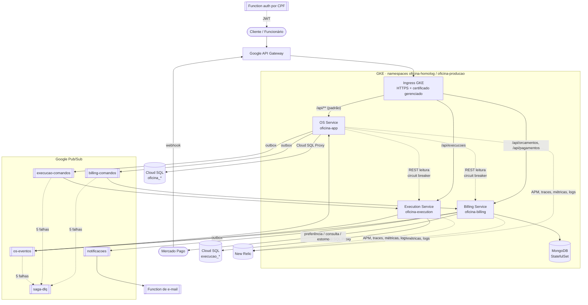
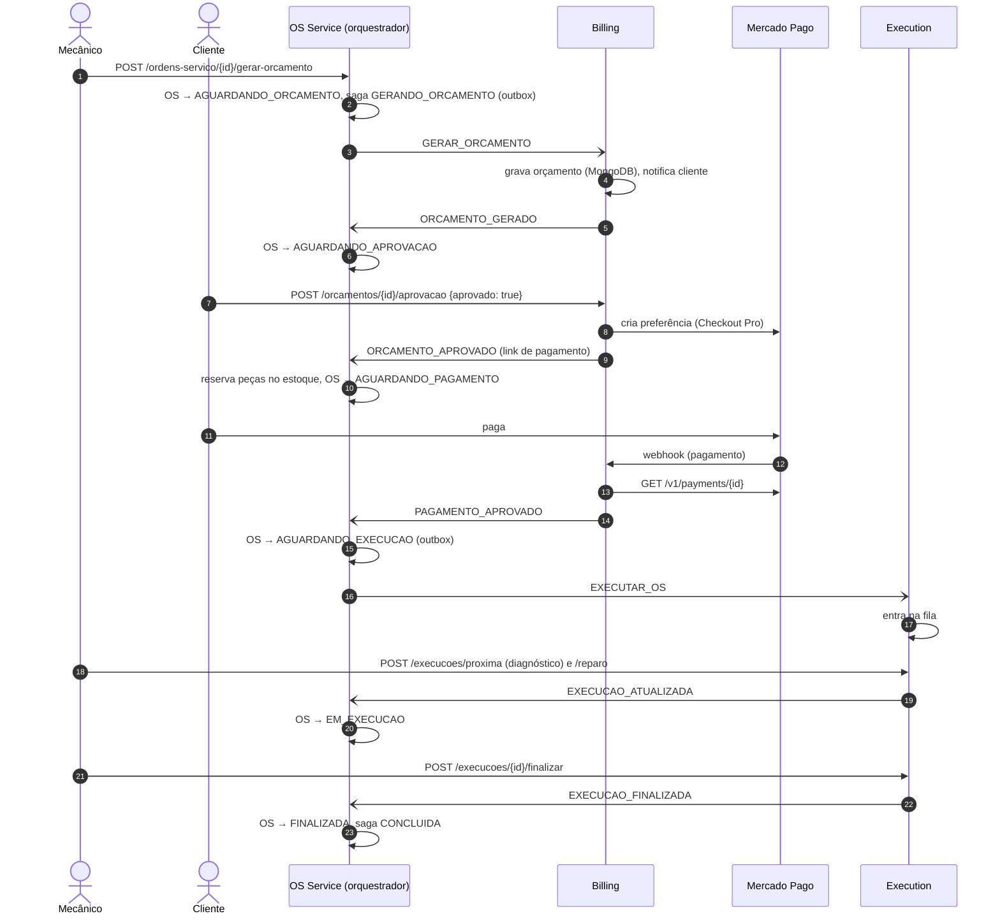
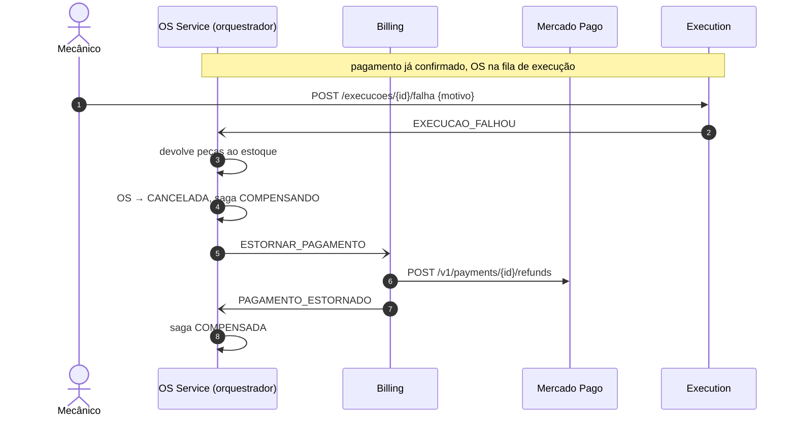
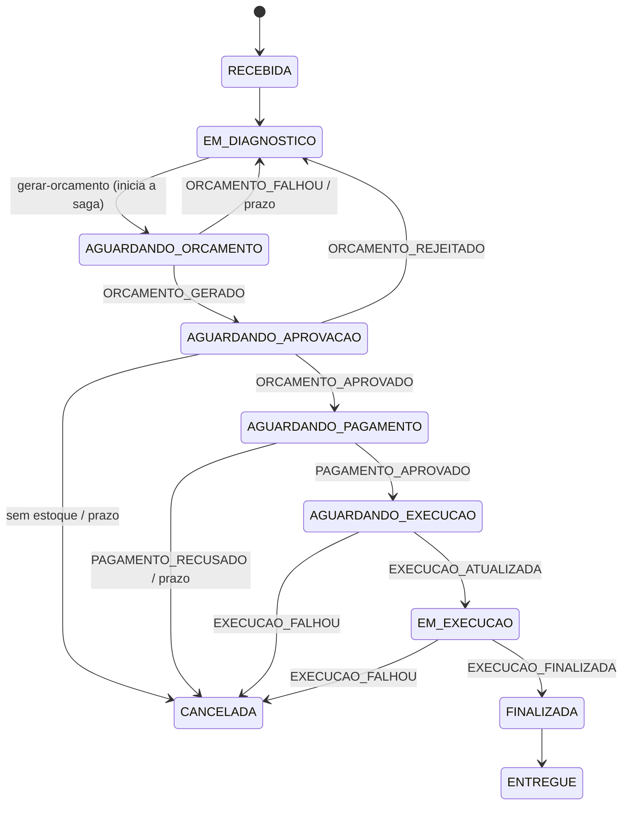

# Arquitetura — Fase 4 (microsserviços)

Visão geral da arquitetura final: três microsserviços, cada um com repositório, banco, pipeline e
manifestos Kubernetes próprios, conversando por Pub/Sub (saga orquestrada) e, só para leitura, por
REST. Decisões detalhadas em [ADR-003](../adrs/003-saga-orquestrada.md),
[ADR-004](../adrs/004-mensageria-pubsub-outbox.md) e
[RFC-004](../rfcs/004-divisao-microsservicos-e-bancos.md).

## 1. Visão geral



| Repositório | Conteúdo |
|---|---|
| [`oficina`](https://github.com/robsonago/oficina) | OS Service + orquestrador da saga + `docker-compose` do ambiente completo |
| [`oficina-billing-service`](https://github.com/robsonago/oficina-billing-service) | Billing Service (MongoDB, Mercado Pago) |
| [`oficina-execution-service`](https://github.com/robsonago/oficina-execution-service) | Execution Service (PostgreSQL, outbox) |
| [`oficina-auth-function`](https://github.com/robsonago/oficina-auth-function) | Functions de autenticação por CPF e envio de e-mail (Fase 3) |
| [`oficina-infra-db`](https://github.com/robsonago/oficina-infra-db) | Cloud SQL: databases/usuários do OS e do Execution |
| [`oficina-infra-k8s`](https://github.com/robsonago/oficina-infra-k8s) | GKE, Pub/Sub da saga, IAM/Workload Identity, configs/secrets, Ingress, API Gateway |

## 2. Saga — caminho feliz



## 3. Saga — falha na execução (compensação)



Os demais cenários de compensação (pagamento recusado, falta de estoque, rejeição, prazo esgotado)
estão descritos no [ADR-003](../adrs/003-saga-orquestrada.md) e automatizados em
[`saga_ordem_servico.feature`](../../src/test/resources/features/saga_ordem_servico.feature).

## 4. Estados



## 5. Observabilidade dos fluxos distribuídos

- **Distributed tracing (New Relic)**: o agente Java instrumenta HTTP automaticamente; nas mensagens
  do Pub/Sub os cabeçalhos de trace são copiados para os atributos na publicação (inclusive via
  outbox) e aceitos no consumo (`Rastreamento.continuar`), então uma OS aparece como um trace que
  atravessa OS Service → Billing → OS Service → Execution.
- **Logs**: JSON com `service`, `correlationId` e `sagaId` em todos os serviços. Consulta no New Relic
  Logs: `sagaId:"<id>"` mostra a saga inteira, de todos os serviços, em ordem.
- **Métricas de negócio** (`/actuator/prometheus`, coletadas pelo `nri-prometheus`):
  `oficina_saga_iniciadas_total`, `oficina_saga_concluidas_total`,
  `oficina_saga_compensadas_total{motivo}`, `oficina_billing_eventos_total{tipo}`,
  `oficina_execucao_fila{status}`, `oficina_outbox_pendentes`, `oficina_integracoes_erros_total`.
- **Consultas NRQL sugeridas para o dashboard da saga**:

```sql
-- sagas por desfecho (últimas 24h)
SELECT sum(oficina_saga_iniciadas_total) AS 'iniciadas', sum(oficina_saga_concluidas_total) AS 'concluídas',
       sum(oficina_saga_compensadas_total) AS 'compensadas' FROM Metric SINCE 1 day ago

-- compensações por motivo
SELECT sum(oficina_saga_compensadas_total) FROM Metric FACET motivo SINCE 1 day ago TIMESERIES

-- tamanho da fila de execução
SELECT latest(oficina_execucao_fila) FROM Metric FACET status TIMESERIES

-- eventos parados na outbox (alerta se > 0 por 5 minutos)
SELECT max(oficina_outbox_pendentes) FROM Metric FACET service TIMESERIES
```
